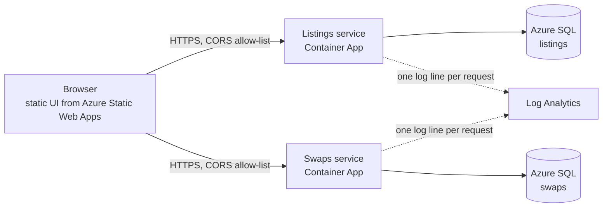

# Thrift-Swap Board

A web app where students post items they want to swap (jacket, textbook, desk lamp).
When someone proposes a swap, the app tells them how fair the trade is:
**Fair trade**, **Lopsided** or **Very uneven**.

**Live URL:** https://kind-forest-0330c0b03.8.azurestaticapps.net

### Production endpoints

| Piece | URL |
|---|---|
| UI (Static Web App) | https://kind-forest-0330c0b03.8.azurestaticapps.net |
| Listings API | https://sdd-3b-g1-listings.blackmoss-282db355.westeurope.azurecontainerapps.io |
| Swaps API | https://sdd-3b-g1-swaps.blackmoss-282db355.westeurope.azurecontainerapps.io |
| Listings `/health` | https://sdd-3b-g1-listings.blackmoss-282db355.westeurope.azurecontainerapps.io/health |
| Swaps `/health` | https://sdd-3b-g1-swaps.blackmoss-282db355.westeurope.azurecontainerapps.io/health |

Azure resource group: `rg-sdd-3b-g1` (prefix `sdd-3b-g1`, West Europe). First request after idle can take up to about a minute while a serverless database resumes. Setup and pipeline details: [`docs/deploy.md`](docs/deploy.md).

## Team and roles

| Member | GitHub | Area |
|---|---|---|
| Abhiram Kidambi | @BlueSinkers | Sprint 0 setup, project docs, reviews, Azure deploy / OIDC |
| Serge Hagopian | @SergeGod | Listings, Swaps, UI, CI/CD, monitoring |
| Rodrigo Martínez Casaú | @RodrigoMartinezCasau | UI restyle, reviews |

Scrum roles (Product Owner and Scrum Master) rotate each sprint; everyone is a Developer. Holders:

| Sprint | Product Owner | Scrum Master |
|---|---|---|
| 0 | Serge Hagopian | Abhiram Kidambi |
| 1 | Abhiram Kidambi | Rodrigo Martínez Casaú |
| 2 | Rodrigo Martínez Casaú | Serge Hagopian |

Outcomes per sprint are in [`docs/scrum/`](docs/scrum/). The backlog lives as GitHub issues
(#3–#12) plus [`docs/product-backlog.md`](docs/product-backlog.md). Create the GitHub Project
board (required by the brief) with:

```bash
gh project create --owner BlueSinkers --title "Thrift-Swap Board Backlog"
# then add issues #3–#12 to that project from the issue sidebar or:
# gh project item-add <number> --owner BlueSinkers --url https://github.com/BlueSinkers/sdd-final-project/issues/<n>
```

Everyone must understand the whole system.

## Architecture



- **Static UI** (plain HTML, CSS and JavaScript, no build step) calls both services
  directly from the browser.
- **Listings service** (own database): CRUD for listings (title, category, condition 1-5,
  estimated value in euros, status open/swapped).
- **Swaps service** (own database): `POST /swaps` takes a snapshot of two listings, computes
  a fairness score, stores the proposal and returns the verdict. This is the feature beyond
  CRUD.
- **The services never call each other.** The UI sends listing snapshots to Swaps, so each
  service keeps working when the other is down. Why: [`docs/decisions.md`](docs/decisions.md).

### Fairness rule

```
adjusted value = estimated value x (0.5 + condition / 10)     condition 1 -> 60%, 5 -> 100%
fairness       = smaller adjusted value / larger adjusted value
```

| Fairness | Verdict |
|---|---|
| 0.8 or above | Fair trade |
| 0.5 up to 0.8 | Lopsided |
| below 0.5 | Very uneven |

Example: a jacket worth 35 euros in condition 4 counts as 31.50; a lamp worth 18 euros in
condition 5 counts as 18.00. 18.00 / 31.50 = 0.57, so the swap is **Lopsided**. The rule is
one pure, unit-tested module: [`swaps/app/fairness.py`](swaps/app/fairness.py).

### When a service is down

| Down | What the user sees |
|---|---|
| Swaps | The board still loads; posting, editing and deleting still work. The proposals section says "Swap checker unavailable" and the Propose swap buttons are disabled. |
| Listings | A clear notice that listings are unavailable. Listings already on screen stay visible. Existing proposals still show. |

Every request from the UI times out after 8 seconds. The page retries every 10 seconds and
recovers on its own. No stack trace or status code is ever shown to a user. CI proves both
cases on every pull request (`tests/e2e/flow.py`).

## API

Listings (`http://localhost:8001`, interactive docs at `/docs`):

| Method | Path | Result |
|---|---|---|
| GET | `/health` | 200 when the service and its database answer, 503 otherwise |
| GET | `/listings` | listings, newest first; `?status=open`, `?category=books`; `?limit=` (1-500, default 200) and `?offset=` |
| POST | `/listings` | 201 with the created listing; 422 if invalid |
| GET | `/listings/{id}` | one listing or 404 |
| PUT | `/listings/{id}` | replaces the listing, keeps its status |
| PATCH | `/listings/{id}/status` | `{"status": "swapped"}` or `"open"` |
| DELETE | `/listings/{id}` | 204, or 404 for an unknown id |

Swaps (`http://localhost:8002`, interactive docs at `/docs`):

| Method | Path | Result |
|---|---|---|
| GET | `/health` | 200 when the service and its database answer, 503 otherwise |
| POST | `/swaps` | 201 with the stored proposal, its fairness score and verdict |
| GET | `/swaps` | recent proposals, newest first; `?limit=`, `?listing_id=` |
| GET | `/swaps/{id}` | one proposal or 404 |
| PATCH | `/swaps/{id}/status` | `accepted` or `declined`; 409 if already decided, or if accepting would put an item in two accepted swaps |

## Run locally

Needs Docker. On Apple Silicon, enable Rosetta in Docker Desktop (SQL Server has no arm64 image).

```bash
cp .env.example .env                # local passwords, git-ignored
docker compose up --build
curl http://localhost:8001/health   # listings
curl http://localhost:8002/health   # swaps
open http://localhost:8080          # the board
```

Each health check returns `{"status":"ok",...}`. The first start takes about a minute: SQL
Server has to be healthy before the services start. If a port is already in use on your
machine, set `LISTINGS_PORT`, `SWAPS_PORT`, `SQL_PORT` or `UI_PORT` in `.env`.

Each service applies its own versioned migrations (`<service>/migrations/NNN_name.sql`) on
startup. Applied files are never edited; a schema change is a new file.

To see the partial-failure behaviour yourself: `docker compose stop swaps`, reload the page,
then `docker compose start swaps` and watch it recover.

## Tests

The tests run against a real SQL Server, never against Azure. With the compose stack up:

```bash
python -m venv .venv && source .venv/bin/activate
pip install -r requirements-dev.txt -r listings/requirements.txt -r swaps/requirements.txt
SA="mssql://sa:<SA_PASSWORD from .env>@localhost:1433"
(cd listings && TEST_DATABASE_URL="$SA/listings_test" pytest --cov=app --cov-fail-under=70)
(cd swaps && TEST_DATABASE_URL="$SA/swaps_test" pytest --cov=app --cov-fail-under=70)
python tests/e2e/flow.py flow       # end to end against the running stack
```

The database named in `TEST_DATABASE_URL` is dropped and recreated on every run, so its name
must end in `_test`. Lint and format: `ruff check .` and `ruff format --check .`.

CI runs all of this on every push and pull request, with a 70% coverage gate (both
services are at 99%), plus a dependency audit (`pip-audit`) and a static security scan
(`bandit`).

## Reproduce the Azure setup

Everything on Azure is created by one re-runnable Azure CLI script, in our group's existing
resource group and named with our group prefix:

```bash
az login
PREFIX=sdd-<class>-g<N> ./infra/setup.sh
```

It creates the Log Analytics workspace, the Container Apps environment, the SQL server with
one serverless database per service, both Container Apps (scale 0 to 1) and the Static Web
App, then prints the GitHub variables and secrets to set. Nothing is changed by hand after
that. The full steps are in [`docs/deploy.md`](docs/deploy.md).

## Deploy, monitoring and the SLO

- Every merge to `main` is built, pushed to GHCR and deployed to Azure Container Apps by
  GitHub Actions, checked with `GET /health`, and smoke-tested from its public URLs.
  Secrets and rollback: [`docs/deploy.md`](docs/deploy.md).
- Request count, error rate and response time come from Log Analytics. Queries and the
  dashboard: [`docs/monitoring.md`](docs/monitoring.md).
- **SLO: 99% of `POST /swaps` requests complete in under 500 ms, measured over 7 days.**

## Documentation

| Document | What it covers |
|---|---|
| [`docs/product-backlog.md`](docs/product-backlog.md) | User stories with acceptance criteria |
| [`docs/scrum/definition-of-done.md`](docs/scrum/definition-of-done.md) | When a backlog item counts as Done |
| [`docs/decisions.md`](docs/decisions.md) | Architecture decision records |
| [`docs/data-model.md`](docs/data-model.md) | Tables, constraints and why swaps store snapshots |
| [`docs/deploy.md`](docs/deploy.md) | Pipeline, Azure setup, secrets, rollback, cold starts |
| [`docs/monitoring.md`](docs/monitoring.md) | Logs, queries, dashboard, SLO |
| [`docs/scrum/`](docs/scrum/) | One file per sprint: goal, items, review, retrospective |
| [`AI_USAGE.md`](AI_USAGE.md) | What AI tools were used for and how the work was checked |

## Working agreement

- No direct pushes to `main`. Every change goes through a PR approved by a teammate.
- No secrets in the repo, ever. Use `.env` (git-ignored) locally and GitHub secrets in CI.
- Done means what [`docs/scrum/definition-of-done.md`](docs/scrum/definition-of-done.md) says.
- Log AI-assisted work in [`AI_USAGE.md`](AI_USAGE.md).
