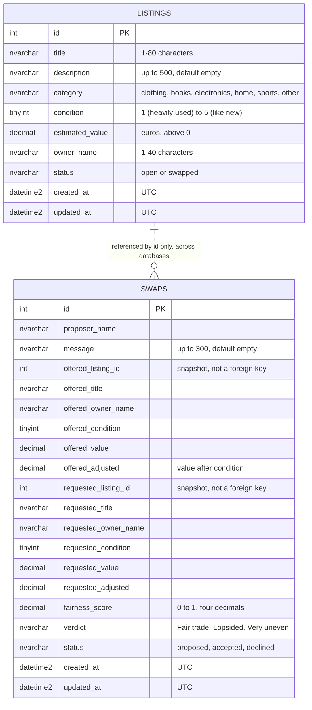
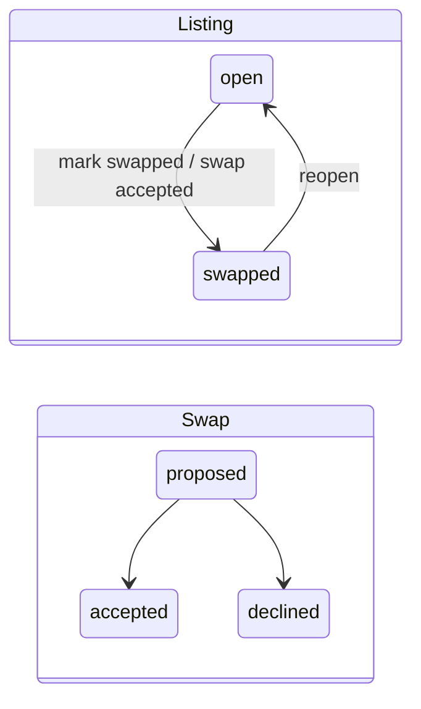

# Data model

Two databases, one per service. Neither service can read the other's database: each connects
with its own database user, which exists only in its own database.

Each database also has a `schema_migrations` table (`version`, `applied_at`) that records
which migration files have been applied.

## Listings database

Defined in [`listings/migrations/001_create_listings.sql`](../listings/migrations/001_create_listings.sql).

- One table, `listings`. Check constraints repeat the API's rules (category list, condition
  1-5, value above 0, status open/swapped), so a bug in the service cannot store a row the
  API would have refused.
- Index on `(status, created_at DESC)`: the board shows open listings, newest first.
- `002_seed_demo_listings.sql` adds six demo listings so a new board is not empty.

## Swaps database

Defined in [`swaps/migrations/001_create_swaps.sql`](../swaps/migrations/001_create_swaps.sql).

- One table, `swaps`. Each row holds a **snapshot** of both listings as they were when the
  swap was proposed, plus both adjusted values, the score and the verdict.
- `offered_listing_id` and `requested_listing_id` are plain integers, not foreign keys. The
  listings live in another database owned by another service, and a proposal must stay
  readable after a listing is edited or deleted.
- Check constraints: two different listings, conditions 1-5, values above 0, score between
  0 and 1, known verdict and status.
- Index on `created_at DESC`: the UI shows the most recent proposals.

## Why swaps store snapshots

The alternative is to store only the two listing ids and look the listings up when needed.
We store a copy instead because:

1. **Independence.** Swaps can score and show proposals while Listings is down (ADR-1, ADR-4).
2. **A proposal is a record of a moment.** The verdict was computed from specific values.
   If the owner later changes the value from 35 to 60 euros, the stored verdict should still
   match the numbers shown next to it.

The cost is that a title shown in an old proposal can be out of date. That is the correct
behaviour for a record of what was proposed.

## Status changes

A swap is decided once: the update is `... WHERE id = ? AND status = 'proposed'`, so two
people deciding at the same moment cannot both succeed (the second gets 409). When a swap is
accepted, the UI marks both listings as swapped with two calls to Listings; the services do
not call each other.

## Money and time

- Values are `DECIMAL(10,2)` in the database, never floating point. The API accepts a number
  and rounds it to cents.
- Timestamps are UTC in the database and are sent with an explicit UTC offset. The browser
  shows them in local time.
